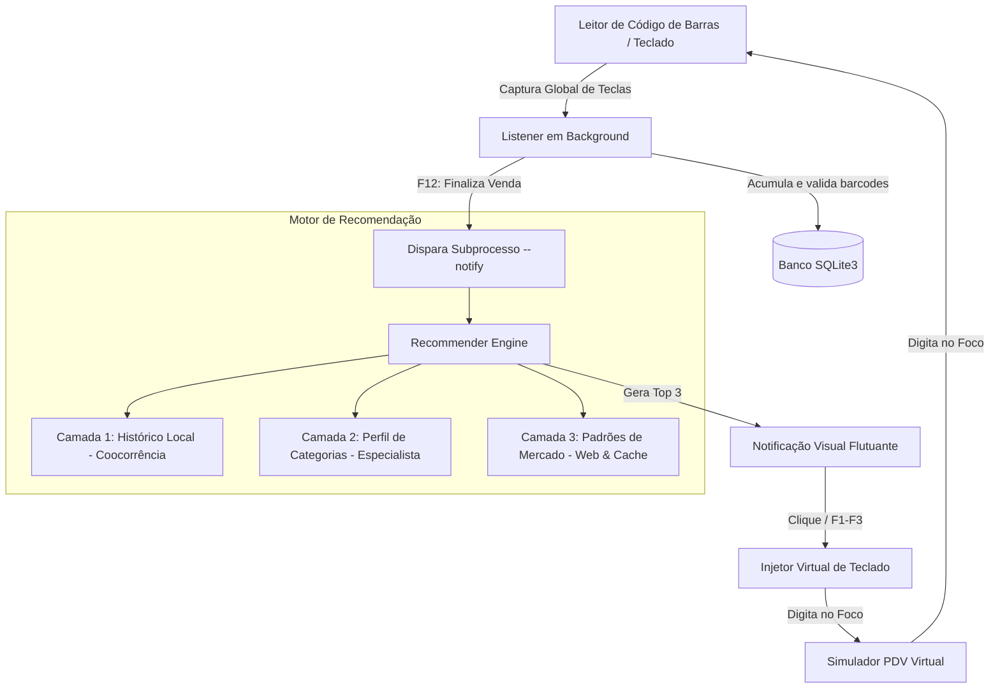

# PdvApp - Frente de Caixa Inteligente e Motor de Recomendações 🛒💡

[](https://www.python.org/)
[](https://www.sqlite.org/)
[](https://docs.python.org/3/library/tkinter.html)
[](https://pyinstaller.org/)

O **PdvApp** é uma solução completa em Python projetada para rodar em segundo plano (*background*) acoplada a sistemas de Ponto de Venda (PDV). Simulando o comportamento de um leitor de código de barras físico (que atua como uma entrada de teclado), o aplicativo captura os itens vendidos em tempo real, analisa o comportamento de compra através de um motor de recomendações em **3 camadas** e sugere dinamicamente produtos complementares em uma interface visual premium.

Idealizado com foco no segmento de **Lojas de Material de Construção**, o projeto serve como um exemplo de arquitetura modular, persistência leve com SQLite3, interceptação de hardware de baixo nível e interfaces gráficas customizadas.

---

## 🏗️ Arquitetura do Sistema

O sistema é dividido em processos e módulos independentes, que se comunicam através da simulação física de teclas e subprocessos, garantindo isolamento total do interceptador e das interfaces gráficas.



---

## 🌟 Funcionalidades Principais

1. **Captura de Entrada Física (Keyboard Wedge Listener):**
   - Hook global de teclado via `pynput` que roda em segundo plano.
   - Buffer inteligente que filtra apenas sequências numéricas (barcodes) correspondentes a produtos reais cadastrados, evitando ruídos de digitação.
   - Reset automático do buffer por timeout (1.5 segundos de inatividade) ou caracteres não-numéricos.

2. **Motor de Sugestão em 3 Camadas:**
   - **Camada 1 (Histórico Local):** Algoritmo de mineração dinâmica que analisa o histórico de compras do banco SQLite. Se os itens A e B estão no carrinho, calcula a coocorrência histórica com o item C:
     $$\text{Confiança}(A, B \rightarrow C) = \frac{\text{Vendas com } \{A, B, C\}}{\text{Vendas com } \{A, B\}}$$
   - **Camada 2 (Perfil de Categorias):** Regras de associação especialistas cadastradas no banco (ex: ao comprar vaso sanitário, sugere o anel de vedação, assento e engate flexível; ao comprar tinta, sugere rolo e fita crepe).
   - **Camada 3 (Padrões Externos da Web):** Consulta assíncrona a uma base de regras hospedada na internet. Inclui mecanismo de cache local e fallback offline (`external_patterns_fallback.json`) caso não haja conexão.

3. **Notificação Flutuante Premium:**
   - Layout *Dark Mode* moderno (fundo azul-escuro com acentos em roxo e azul neon) construído em Tkinter.
   - Janela *borderless* e flutuante que se posiciona acima da barra de tarefas do Windows.
   - **Animações fluidas:** *slide-up* (desliza para cima) ao abrir e *slide-down* (desliza para baixo) ao fechar.
   - Barra de contagem regressiva visual (timer de 10 segundos) que **pausa ao passar o mouse** (*hover*) e retoma ao sair.
   - Atalhos físicos rápidos (`F1`, `F2` e `F3`) para selecionar as sugestões diretamente pelo teclado físico.

4. **Simulador de Frente de Caixa (PDV Virtual):**
   - Interface visual completa de caixa registradora.
   - Catálogo categorizado de produtos (Hidráulica, Elétrica, Banheiro, Cozinha, Pintura).
   - Botão para **Simular Bip Físico** que injeta a digitação de códigos via hardware para testar o listener em background de forma 100% interativa.

---

## 📂 Estrutura de Arquivos

```
PdvApp/
│
├── README.md                      # Documentação completa do projeto
├── requirements.txt               # Dependências do projeto (pynput, pyinstaller)
├── build_exe.py                   # Script de compilação automática para executável
├── main.py                        # Ponto de entrada unificado (seletor CLI)
│
├── database/
│   ├── db_manager.py              # Schema SQLite, sementes de dados e CRUDs
│   └── pdv_store.db               # Banco de dados local gerado no primeiro boot
│
├── core/
│   ├── listener.py                # Interceptador global do teclado
│   ├── recommender.py             # Engine de sugestões de 3 camadas
│   └── external_patterns.py       # Gerenciador de download e cache de regras web
│
├── ui/
│   ├── notification_window.py     # Popup animado de sugestões de compra
│   └── simulator_app.py           # Simulador gráfico do PDV Virtual
│
└── data/
    ├── products.json              # Dados de produtos para semente
    ├── local_history_seed.json    # Histórico de compras simulado para semente
    └── external_patterns_fallback.json # Backup offline de regras de associação
```

---

## 🛠️ Instalação e Execução

### Pré-requisitos
- Python 3.8 ou superior instalado.
- Sistema operacional Windows (para suporte completo a hooks globais sem dependência de X11).

### Passo 1: Clonar e instalar dependências
```bash
# Clone o repositório
git clone https://github.com/seu-usuario/PdvApp.git
cd PdvApp

# Crie e ative um ambiente virtual
python -m venv venv
.\\venv\\Scripts\\activate

# Instale os pacotes necessários
pip install -r requirements.txt
```

### Passo 2: Executar em Modo Desenvolvimento
O arquivo `main.py` atua como seletor através de parâmetros de linha de comando:

```bash
# 1. Inicie o Listener em background em um terminal dedicado:
python main.py --listener

# 2. Em outro terminal, inicie o Simulador de PDV:
python main.py
```

*Com ambas as janelas abertas, selecione produtos no Simulador e clique em "Simular Bip Físico" ou digite os códigos diretamente. Ao clicar em **"Finalizar Venda (F12)"**, o Listener detectará o comando, processará as sugestões e exibirá a notificação visual.*

---

## 📦 Empacotamento para Executável (`.exe`)

O projeto está configurado para ser compilado em um **único executável consolidado** que gerencia todas as frentes (Simulador, Listener e Popup).

Rode o script de compilação:
```bash
python build_exe.py
```

O PyInstaller empacotará os scripts do core, as telas, as dependências do `pynput` e a pasta de dados (`data/`) para dentro de `dist/PdvApp.exe`. 

**Para rodar a versão compilada:**
1. Abra um terminal e execute o interceptador em segundo plano:
   ```bash
   .\\dist\\PdvApp.exe --listener
   ```
2. Abra outra instância clicando duas vezes no arquivo `PdvApp.exe` (ou rodando `.\\dist\\PdvApp.exe` sem argumentos) para abrir o Simulador.

*Nota: O banco de dados `pdv_store.db` será criado em uma pasta `database/` persistente ao lado do executável, garantindo que o histórico de vendas não seja apagado ao fechar a aplicação.*

---

## 💡 Detalhes Técnicos do Motor de Recomendação

### Algoritmo de Mineração (Histórico Local)
O motor do histórico local não requer bibliotecas pesadas de Data Mining como Spark ou Pandas, rodando inteiramente em cima do banco SQLite com uma estrutura de dados de alto desempenho:
1. Recupera as compras concluídas como conjuntos de dados.
2. Filtra transações que contêm a interseção com o carrinho do cliente.
3. Classifica a confiança de cada item adicional sugerido e pondera o peso com base na quantidade de itens comprados em conjunto (antecedentes).

### Regras Especialistas (Material de Construção)
Foi estruturada uma base relacional no SQLite com regras de projeto técnico:
- **Projeto Banheiro:** A compra da *Bacia Sanitária (3001)* ativa a recomendação do *Anel de Vedação (3003)* com a justificativa *"Necessário anel de vedação para a instalação do vaso"* e *Assento (3002)*.
- **Projeto Hidráulico:** A compra do *Cano PVC (1001)* dispara o gatilho para *Adesivo PVC (1003)* e *Luva Soldável (1002)*.

---

## 📄 Licença

Este projeto está sob a licença MIT. Veja o arquivo [LICENSE](LICENSE) para detalhes.
